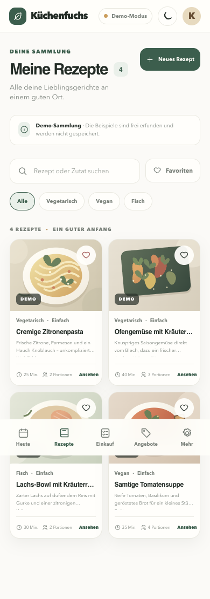
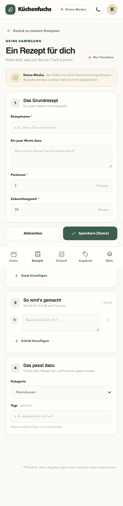
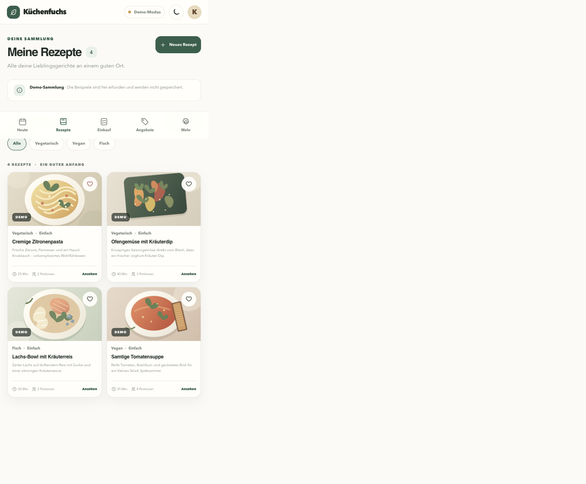

# Küchenfuchs

**Clever kochen. Günstiger einkaufen.**

Küchenfuchs ist eine geplante selbst gehostete Progressive Web App zur Rezeptverwaltung, Essensplanung und Einkaufsoptimierung anhand aktueller Supermarktangebote.

## Status

**P0 – lokale Compose-Basis:** Abgeschlossen und nach `main` gemergt.

**P1 – iPhone-first UI-Grundlage:** In Arbeit auf `feature/p1-ui`; die Rezepte sind Beispieldaten im nicht-persistenten Demo-Modus.

## Zielbild

- Rezepte verwalten, importieren und mit KI erstellen
- Wochenplan und synchronisierte Einkaufsliste
- Angebote ausgewählter Lebensmittelmärkte erfassen und mit Rezeptzutaten abgleichen
- Einkaufsempfehlungen unter Berücksichtigung von Preisen, Packungsgrößen und Einkaufsstopps
- Auf eigenem Linux-Server per Docker Compose betreiben
- Integration mit ChatGPT via abgesicherter API und KI-Assistent in der PWA

## Vorgehen

Die Architektur und der Implementierungsplan wurden geprüft. Arbeitspakete benötigen jeweils eine ausdrückliche Freigabe.

## Lokale Entwicklung (P0)

Voraussetzungen: Docker mit Docker Compose v2.29 oder neuer. Die Entwicklung läuft über Compose; PostgreSQL erhält keinen Host-Port. Caddy ist lokal standardmäßig unter `http://localhost:8080` erreichbar und benötigt weder öffentliche Domain noch öffentliches TLS-Zertifikat. Ist Port 8080 belegt, `HTTP_PORT` in `.env` ändern.

```sh
cp .env.example .env
docker compose up --build --detach
```

Die Beispielwerte sind ausdrücklich ausschließlich für lokale Entwicklung gedacht und nicht als produktive Secrets geeignet. Compose verlangt `POSTGRES_PASSWORD`; für Produktion muss ein eigenes sicheres Secret gesetzt werden. Für Start, Stopp, Neustart, Logs und automatisierte P0-Tests siehe [docs/deployment.md](docs/deployment.md).

Die P0-Smoke-Tests lassen sich mit `./scripts/test-p0.sh` ausführen. Sie bauen die Images, starten einen isolierten Test-Stack und entfernen diesen danach wieder.

## Oberfläche lokal prüfen (P1)

Die empfohlene Ansicht läuft im vollständigen Stack hinter Caddy. Falls `.env` noch nicht vorhanden ist, zuerst `cp .env.example .env` ausführen und ausschließlich das lokale Beispielkennwort verwenden.

```sh
docker compose up --build --detach
# Oberfläche: http://localhost:8080
docker compose stop
# Später fortsetzen:
docker compose start
# Änderungen neu bauen:
docker compose up --build --detach
```

Für reine Angular-Entwicklung ohne API oder Service Worker:

```sh
cd frontend
npm ci
npm start
# http://localhost:4200
```

Frontend-Build und UI-Komponententests:

```sh
cd frontend
npm run build
npm test
```

Die Navigation, Rezepte und der Editor sind im Demo-Modus bedienbar; Rezeptänderungen werden nicht gespeichert. Die Service-Worker-Registrierung ist im Development-Server deaktiviert. Der Produktionsbuild über Compose liefert Manifest, Icons und einen Service Worker für App-Shell und statische Dateien aus, jedoch keine Offline-Datensynchronisation. Auf iPhone/iPad wird die Installation in Safari über „Zum Home-Bildschirm“ angeboten; Installation auf einem echten Gerät setzt einen sicheren HTTPS-Ursprung voraus. Das lokale Compose-Setup nutzt HTTP und eignet sich daher nicht als iOS-Installationsziel.

Responsive Kontrolle: Browser-Viewport auf **390 × 844 px** (iPhone-Größe) und auf mindestens **1280 × 800 px** (Desktop) stellen. Auf Mobilgeräten die Navigation unten, Safe-Area-Abstände, Rezeptkarten und den Editor prüfen. Unter Desktop sollte die Seitenleiste angezeigt werden. Es werden keine externen kostenpflichtigen APIs oder Remote-Foodbilder geladen.

### P1 UI-Screenshots

Die folgenden Screenshots zeigen den responsiven Rezeptbereich und den Demo-Editor:







**Auftrag und Regeln:** [CLAUDE.md](CLAUDE.md)  
**Produktanforderungen:** [docs/PROJECT_BRIEF.md](docs/PROJECT_BRIEF.md)

## Hinweis

Externe Angebotsdatenquellen müssen vor der produktiven Nutzung hinsichtlich Zuverlässigkeit, Nutzungsrechten und Regionalität geprüft werden. Es dürfen keine Preise oder Integrationen erfunden werden.
