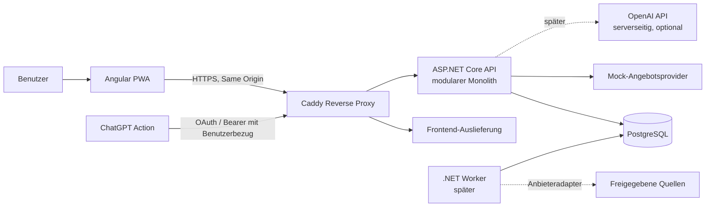

# Küchenfuchs – Architektur

**Stand:** 10. Oktober 2026 · **Status:** Planung, nicht zur Implementierung freigegeben

## Architekturziel

Eine privat betriebene, mobile-first PWA für einen zunächst einzelnen Entwickler. Der bevorzugte Ausgangspunkt ist ein modularer Monolith mit klaren fachlichen Grenzen, nicht eine Sammlung von Microservices. Der erste vollständige Ablauf muss vollständig mit deterministischen Mock-Angeboten funktionieren. Reale Angebotsbeschaffung und KI bleiben austauschbare, ausdrücklich freizugebende Integrationen.

## Komponenten

| Komponente | Verantwortung | Vorgeschlagene Technik |
|---|---|---|
| PWA | Rezepte, Essensplan, Einkaufsliste, Angebotsvergleich; responsive und offline-lesbar | Angular, TypeScript, Angular Service Worker/PWA |
| API | Authentifizierung, Validierung, Fachregeln, REST/OpenAPI, Berechtigungen | ASP.NET Core Web API |
| Fachmodule im API-Prozess | Rezepte, Lebensmittel/Einheiten, Planung/Einkauf, Angebote/Matching, optionale KI | .NET-Projekte oder klar getrennte Modulbereiche im selben Deployable |
| Persistenz | Transaktionale Daten und Migrationen | PostgreSQL, EF Core |
| Angebots-Worker | Später zeitgesteuerte Quellenaktualisierung; zunächst nicht notwendig | .NET Worker, zunächst deaktiviert bzw. ohne echte Quellen |
| Reverse Proxy | HTTPS, Routing zu PWA/API, Sicherheitsheader | Caddy oder Traefik; Empfehlung: Caddy für einen einzelnen Host und kleine Betriebsfläche |
| Externe Dienste | Optional OpenAI API für KI; separate ChatGPT-Actions-Aufrufe der authentifizierten API | Backend-zu-Backend-Verbindungen, keine Schlüssel in der PWA |

Angular und ASP.NET Core werden als getrennte Deployables gebaut, aber gemeinsam versioniert und über denselben Ursprung ausgeliefert. Das vereinfacht SameSite-Cookies, CORS und API-Aufrufe. Der Reverse Proxy stellt `/` für das Frontend und `/api` für die API bereit. PostgreSQL ist ausschließlich im internen Compose-Netz verfügbar. Ein separater Worker wird erst eingeführt, wenn es tatsächlich geplante Angebotsjobs gibt.

## Fachliche Modulgrenzen

1. **Identität und Haushalt:** Benutzer, Haushalt und Mitgliedschaft; MVP zunächst für einen privaten Haushalt, Daten dennoch haushaltsbezogen.
2. **Rezepte:** Rezept, Version/Metadaten, Zutatenzeilen, Schritte, Tags und Favoriten. Eine Rezeptzutat ist eine Mengenangabe für ein normalisiertes Lebensmittel, nicht ein Händlerartikel.
3. **Lebensmittel und Einheiten:** Normalisierte Lebensmittel, Einheitendimensionen und explizite Umrechnungen.
4. **Planung und Einkauf:** Planpositionen, Einkaufslisten, aggregierte und manuell ergänzte Einträge.
5. **Angebote:** Händler, Filiale/Region, Händlerprodukt und zeitlich gültiges Angebot. Adapter hinter einem gemeinsamen Provider-Vertrag; im MVP ausschließlich Mock.
6. **Matching und Optimierung:** nachvollziehbare Regeln und Unsicherheitskennzeichnung; keine erfundene Preis- oder Produktdeckung.
7. **KI:** serverseitige, begrenzte Aufrufe und schema-validierte Vorschläge; niemals automatische Speicherung.

Module teilen sich API-Prozess und Datenbank, besitzen aber definierte Schreibverantwortung. Direkte Modul-zu-Modul-Tabellenzugriffe sollen vermieden werden. Für den MVP reichen ein API-Deployable, eine PostgreSQL-Datenbank und ein Mock-Provider; keine Message Queue, kein Cache-Dienst und keine Microservices.

## Datenflüsse

### Rezeptorientierter Einkauf

1. Nutzer wählt Rezepte und Portionszahlen im Wochenplan aus.
2. API skaliert Rezeptzutaten und aggregiert nur dimensions- und lebensmittelkompatible Mengen.
3. API erstellt eine Einkaufsliste mit Herkunftsverweisen auf Rezept/Planposition; unklare oder nicht konvertierbare Mengen werden getrennt angezeigt.
4. Matching gleicht normalisierte Lebensmittel mit Mock-Händlerprodukten und deren gültigen Angeboten ab.
5. Optimierer vergleicht bekannte Packungskosten, Anzahl der Einkaufsstopps und optionale Vorräte. Fehlende Preise bleiben sichtbar „unbekannt“.
6. UI zeigt Empfehlung, Angebotszeitraum, Quelle/Mock-Kennzeichnung, Packungsanzahl und ungelöste Positionen.

### Angebotsorientierte Planung

1. PWA fragt Angebote für eine Region/Filiale und einen Zeitbezug ab.
2. Angebot und Produkt bleiben von Lebensmittel und Rezeptzutat getrennt.
3. Nur ausreichend sichere Zuordnungen werden in Vorschläge einbezogen; Nutzer können Zuordnungen prüfen.
4. Rezeptvorschläge enthalten die verwendeten Angebote als Begründung, nicht als Verfügbarkeitsgarantie.

### KI-Rezeptvorschlag

Die PWA sendet nur erforderliche, nutzerfreigegebene Eingaben an die API. Die API ruft den KI-Anbieter auf, validiert eine strukturierte Ausgabe und gibt einen Entwurf zurück. Erst nach sichtbarer Prüfung und Nutzeraktion wird ein Rezept über den normalen Rezept-Endpunkt gespeichert.

### Externes ChatGPT

Ein ChatGPT-Action-Client ruft mit nutzerbezogener Authentifizierung einen eng begrenzten Küchenfuchs-Endpunkt auf. Das Schreiben erfordert einen ausdrücklichen Speichervorgang. Keine ungeschützten Schreib-Endpunkte und kein globaler API-Schlüssel im Action-Schema.

## Systemübersicht

## Qualitäts- und Betriebsprinzipien

- REST-Verträge über OpenAPI; API-Eingaben serverseitig validieren und ausgabenbezogen versionieren.
- Einheitliche Fehlerantworten (Problem Details), strukturierte Logs, Request-ID, Health Checks für Prozess und Datenbank.
- Datenbankmigrationen reproduzierbar und vor Produktion überprüfbar; Backups und Restore-Test als Betriebsanforderung.
- API und Datenbank nicht direkt öffentlich exponieren; TLS am Reverse Proxy, Secrets außerhalb des Repositories.
- Offline-Modus bewusst begrenzen: statische App-Shell sowie zuletzt geladene Rezepte und Listen lesen; lokale Änderungen als ausstehend markieren und erst mit Konfliktprüfung synchronisieren.
- Datenquellen und KI als Ausfallgrenzen behandeln: Oberfläche muss auch bei nicht verfügbarem Provider nutzbar bleiben.

## Abgrenzung der ersten Freigabe

Diese Dokumentation ist keine Implementierungsfreigabe. Der erste MVP-Durchstich verwendet lokale Testdaten/Mock-Angebote. Echte Händlerquellen, automatische Importe, ChatGPT-Action-OAuth und produktive KI-Kosten werden nicht vorausgesetzt.
