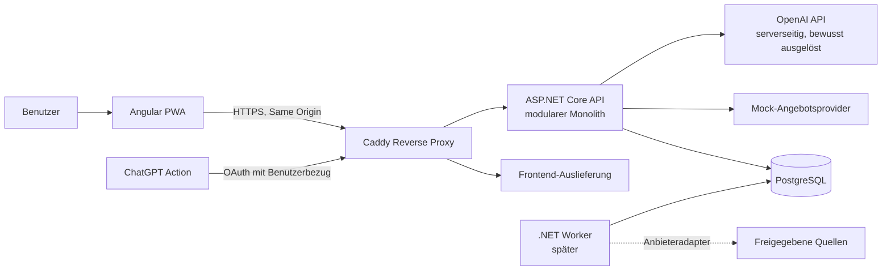

# Küchenfuchs – Architektur

**Stand:** 10. Oktober 2026 · **Status:** Planung, nicht zur Implementierung freigegeben

## Architekturziel

Eine privat betriebene, mobile-first und installierbare Online-PWA für einen zunächst einzelnen Entwickler. Der bevorzugte Ausgangspunkt ist ein modularer Monolith mit klaren fachlichen Grenzen, nicht eine Sammlung von Microservices. Vom ersten Entwicklungspaket an ist die gesamte lokale Laufzeit über Docker Compose vorgesehen. Rezeptverwaltung und KI-Rezeptentwürfe sind frühe Kernfunktionen; die externe ChatGPT-Integration wird ebenfalls früh mit benutzerbezogener Autorisierung eingeplant. Angebotsquellen werden parallel früh auf Machbarkeit geprüft. Mock-Angebote bleiben der deterministische Test- und Fallback-Pfad.

## Komponenten

| Komponente | Verantwortung | Vorgeschlagene Technik |
|---|---|---|
| PWA | Rezepte, KI-Rezeptentwürfe, Essensplan, Einkaufsliste, Angebotsvergleich; responsive und installierbar, im ersten Schritt online | Angular, TypeScript, Angular PWA |
| API | Authentifizierung, Validierung, Fachregeln, REST/OpenAPI, Berechtigungen; serverseitige KI- und ChatGPT-Action-Endpunkte | ASP.NET Core Web API |
| Fachmodule im API-Prozess | Rezepte, Lebensmittel/Einheiten, Planung/Einkauf, Angebote/Matching, optionale KI | .NET-Projekte oder klar getrennte Modulbereiche im selben Deployable |
| Persistenz | Transaktionale Daten und Migrationen | PostgreSQL, EF Core |
| Angebots-Worker | Erst nach positivem Machbarkeitsnachweis zeitgesteuerte Quellenaktualisierung | .NET Worker nur bei tatsächlichem Bedarf; kein eigener Dienst im ersten vertikalen Durchstich |
| Reverse Proxy | HTTPS, Routing zu PWA/API, Sicherheitsheader | Caddy oder Traefik; Empfehlung: Caddy für einen einzelnen Host und kleine Betriebsfläche |
| Externe Dienste | Optional OpenAI API für KI; separate ChatGPT-Actions-Aufrufe der authentifizierten API | Backend-zu-Backend-Verbindungen, keine Schlüssel in der PWA |

Angular und ASP.NET Core werden als getrennte Deployables gebaut, aber gemeinsam versioniert und über denselben Ursprung ausgeliefert. Das vereinfacht SameSite-Cookies, CORS und API-Aufrufe. Der Reverse Proxy stellt `/` für das Frontend und `/api` für die API bereit. Schon das erste lokale Entwicklergerüst wird samt PostgreSQL, API und Frontend durch Docker Compose gestartet; die Datenbank bleibt ausschließlich im internen Compose-Netz verfügbar. Ein separater Worker wird erst eingeführt, wenn es tatsächlich geplante Angebotsjobs gibt.

## Fachliche Modulgrenzen

1. **Identität und Haushalt:** Benutzer, Haushalt und Mitgliedschaft; MVP zunächst für einen privaten Haushalt, Daten dennoch haushaltsbezogen.
2. **Rezepte:** Rezept, Version/Metadaten, Zutatenzeilen, Schritte, Tags und Favoriten. Eine Rezeptzutat ist eine Mengenangabe für ein normalisiertes Lebensmittel, nicht ein Händlerartikel.
3. **Lebensmittel und Einheiten:** Normalisierte Lebensmittel, Einheitendimensionen und explizite Umrechnungen.
4. **Planung und Einkauf:** Planpositionen, Einkaufslisten, aggregierte und manuell ergänzte Einträge.
5. **Angebote:** Händler, Filiale/Region, Händlerprodukt und zeitlich gültiges Angebot. Adapter hinter einem gemeinsamen Provider-Vertrag; im MVP ausschließlich Mock.
6. **Matching und Optimierung:** nachvollziehbare Regeln und Unsicherheitskennzeichnung; keine erfundene Preis- oder Produktdeckung.
7. **KI und externe Integration:** früh verfügbare serverseitige, begrenzte Aufrufe und schema-validierte Vorschläge; Rezeptentwürfe werden niemals automatisch gespeichert. ChatGPT erhält ausschließlich nutzerbezogen autorisierte, eng begrenzte REST-Aktionen.

Module teilen sich API-Prozess und Datenbank, besitzen aber definierte Schreibverantwortung. Direkte Modul-zu-Modul-Tabellenzugriffe sollen vermieden werden. Für den MVP reichen ein API-Deployable, eine PostgreSQL-Datenbank und ein Mock-Provider; keine Message Queue, kein Cache-Dienst und keine Microservices.

## Datenflüsse

### Rezeptorientierter Einkauf

1. Nutzer wählt Rezepte und Portionszahlen im Wochenplan aus.
2. API skaliert Rezeptzutaten und aggregiert nur dimensions- und lebensmittelkompatible Mengen.
3. API erstellt eine Einkaufsliste mit Herkunftsverweisen auf Rezept/Planposition; unklare oder nicht konvertierbare Mengen werden getrennt angezeigt.
4. Matching gleicht normalisierte Lebensmittel mit Mock-Händlerprodukten und deren gültigen Angeboten ab.
5. Optimierer vergleicht bekannte Packungskosten, Anzahl der Einkaufsstopps und optionale Vorräte. Fehlende Preise bleiben sichtbar „unbekannt“.
6. UI zeigt Empfehlung, Angebotszeitraum, Quelle/Mock-Kennzeichnung, Packungsanzahl und ungelöste Positionen.

### Angebotsorientierte Planung

1. PWA fragt Angebote für eine Region/Filiale und einen Zeitbezug ab.
2. Angebot und Produkt bleiben von Lebensmittel und Rezeptzutat getrennt.
3. Nur ausreichend sichere Zuordnungen werden in Vorschläge einbezogen; Nutzer können Zuordnungen prüfen.
4. Rezeptvorschläge enthalten die verwendeten Angebote als Begründung, nicht als Verfügbarkeitsgarantie.

### KI-Rezeptvorschlag

Die PWA sendet nur erforderliche, nutzerfreigegebene Eingaben an die API. Die API ruft den KI-Anbieter auf, validiert eine strukturierte Ausgabe und gibt einen Entwurf zurück. Erst nach sichtbarer Prüfung und Nutzeraktion wird ein Rezept über den normalen Rezept-Endpunkt gespeichert.

### Externes ChatGPT

Ein ChatGPT-Action-Client ruft mit nutzerbezogener Authentifizierung einen eng begrenzten Küchenfuchs-Endpunkt auf. Das Schreiben erfordert einen ausdrücklichen Speichervorgang. Keine ungeschützten Schreib-Endpunkte und kein globaler API-Schlüssel im Action-Schema.

Die PWA und ChatGPT sind zwei getrennte Clients mit eigenen Authentifizierungsflüssen. Die PWA verwendet in P2 ASP.NET Core Identity mit einer Same-Origin-Cookie-Session; ChatGPT Actions benötigt dagegen OAuth-Token im Authorization-Header. Küchenfuchs implementiert keinen eigenen OAuth-/OIDC-Autorisierungsserver. Für P5a wird ein bestehender Identity Provider (bevorzugt Keycloak als selbst betriebener Kandidat) als Ausgabeinstanz für Actions-Token geprüft. Die API validiert dessen Token und ordnet die stabile Provider-Identität einer internen Küchenfuchs-Identität und deren Haushaltsrechten zu. Vor einer Festlegung sind Kontoverknüpfung, Scopes, Token-Widerruf, Redirect-Allowlist und ein echter End-to-End-Test gegen die dann aktuelle ChatGPT-Actions-Spezifikation nachzuweisen. P2 allein stellt ausdrücklich noch keinen OAuth-Endpunkt für ChatGPT bereit.

Die Trennung vermeidet, dass die PWA-Cookie-Session als Action-Token missbraucht wird. Ein externer Provider bedeutet zusätzliche Betriebs- und Kontoverknüpfungsarbeit; falls dies für den privaten MVP nicht tragbar ist, bleiben Actions zurückgestellt und die PWA-KI-Funktion unabhängig nutzbar. Belege und offene Entscheidung: [API-Design](./api-design.md#chatgpt-actions-und-oauthoidc) und [offene Entscheidungen](./open-decisions.md).

## Systemübersicht

## Qualitäts- und Betriebsprinzipien

- REST-Verträge über OpenAPI; API-Eingaben serverseitig validieren und ausgabenbezogen versionieren.
- Einheitliche Fehlerantworten (Problem Details), strukturierte Logs, Request-ID, Health Checks für Prozess und Datenbank.
- Datenbankmigrationen reproduzierbar und vor Produktion überprüfbar; Backups und Restore-Test als Betriebsanforderung.
- API und Datenbank nicht direkt öffentlich exponieren; TLS am Reverse Proxy, Secrets außerhalb des Repositories.
- Erster PWA-Schritt ist installierbar und online arbeitend. Offline-Datencache, lokale Schreibwarteschlange und Konfliktbehandlung sind ausdrücklich vertagt.
- Datenquellen und KI als Ausfallgrenzen behandeln: Oberfläche muss auch bei nicht verfügbarem Provider nutzbar bleiben.

## Abgrenzung der ersten Freigabe

Diese Dokumentation ist keine Implementierungsfreigabe. Im frühen funktionsfähigen Stand werden lokale Testdaten/Mock-Angebote verwendet, während ein eigener Machbarkeitsnachweis mindestens eine reale Quelle technisch und rechtlich prüft. Eine produktive Quellenanbindung erfolgt nur bei positivem Nachweis und separater Freigabe. KI-Rezeptentwürfe und die externe ChatGPT-Integration sind dagegen frühe Anwendungsfunktionen und erhalten eigene Sicherheits-, Kosten- und Abnahmeschranken. Offline-Synchronisation und komplexe Konfliktbehandlung sind nicht Bestandteil des ersten Schritts.
