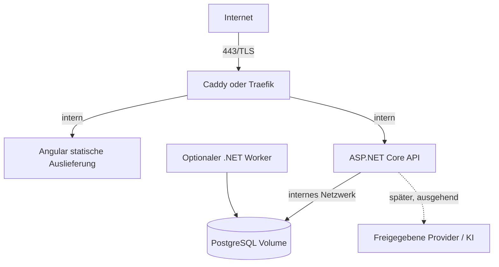

# Küchenfuchs – Deployment- und Betriebskonzept

**Stand:** 11. Oktober 2026 · **Status:** Betriebszielbild; keine Ressourcen werden mit diesem Dokument gestartet oder provisioniert

## Keycloak und ChatGPT-OAuth (P5a.1/P5a.2)

Keycloak ist der OAuth-/OIDC-Provider. Seit P5a.2 läuft er unter `/auth` derselben Origin wie Küchenfuchs: Der Küchenfuchs-Caddy leitet ausschließlich `/auth/realms/kuechenfuchs/*` und `/auth/resources/*` an Keycloak weiter (`deploy/caddy/routes.d/keycloak.caddy`), alles andere unter `/auth` beantwortet er mit `404`. Die Schritt-für-Schritt-Anleitung für den Heimserver steht in [homeserver-setup.md](./homeserver-setup.md).

```sh
# Lokal: .env zusätzlich befüllen (Werte lokal erzeugen, siehe .env.example):
# KEYCLOAK_DB_PASSWORD, KEYCLOAK_ADMIN_PASSWORD, KEYCLOAK_LINK_CLIENT_SECRET,
# KEYCLOAK_CHATGPT_ACTIONS_CLIENT_SECRET, KEYCLOAK_API_ADMIN_CLIENT_SECRET.
docker compose -f compose.yaml -f compose.keycloak.yaml up --build --detach
# Keycloak über Küchenfuchs: http://localhost:${HTTP_PORT}/auth/realms/kuechenfuchs/...
# Admin-Konsole (nur Loopback): http://localhost:${KEYCLOAK_ADMIN_PORT:-8180}/auth/admin/

# Heimserver (Production, erst nach Freigabe):
docker compose -f compose.yaml -f compose.keycloak.yaml -f compose.homeserver.yaml up --build --detach
```

| Dienst | Netz | Host-Port | Persistenz |
|---|---|---|---|
| `caddy` (Küchenfuchs-Web) | `backend`, `ingress` | `${HTTP_BIND_ADDRESS:-127.0.0.1}:${HTTP_PORT}` – Upstream des Heimserver-Caddys | – |
| `keycloak` | `keycloak-backend`, `backend`, `ingress` | nur `127.0.0.1:${KEYCLOAK_ADMIN_PORT}` (Admin-Konsole/SSH-Tunnel) | in `keycloak-db` |
| `keycloak-db` (PostgreSQL 17.11) | nur `keycloak-backend` (intern) | keiner | Volume `keycloak_postgres_data` |
| `api` | `backend` (erreicht Keycloak, nicht `keycloak-db`) | keiner | unverändert |
| `migrate` (nur `compose.homeserver.yaml`) | `backend` | keiner | führt `--migrate` einmalig aus; die API startet erst danach |

- **Versionen:** Keycloak `26.7.5` (Digest in `deploy/keycloak/Dockerfile`, vorab per `kc.sh build` mit PostgreSQL, Health und `http-relative-path=/auth` optimiert), PostgreSQL `17.11-alpine` und Caddy `2.11.7-alpine` jeweils mit Digest (Stand 11.10.2026).
- **Issuer/Hostname:** `KC_HOSTNAME=${KUECHENFUCHS_PUBLIC_URL}/auth` (lokal Standard `http://localhost:${HTTP_PORT}/auth`, Heimserver `https://kuechenfuchs.zaddach.org/auth`). Nie aus Request-Headern. `KC_HOSTNAME_BACKCHANNEL_DYNAMIC=true` liefert der API intern `http://keycloak:8080/auth` für Token-, JWKS- und Admin-Aufrufe. `KC_HOSTNAME_ADMIN` zeigt auf den Loopback-Port. `KC_PROXY_HEADERS=xforwarded` nur von privaten Adressen (`KC_PROXY_TRUSTED_ADDRESSES`).
- **API hinter TLS-Proxy:** In Production setzt `compose.homeserver.yaml` `ReverseProxy__TrustForwardedHeaders=true` und `ReverseProxy__KnownProxies` auf die feste Adresse des Küchenfuchs-Caddys (`KUECHENFUCHS_PROXY_IP` in einem festen Subnetz). Die API übernimmt `X-Forwarded-Proto`/`-For` nur von diesem Absender und nur eine Weiterleitungsstufe; ohne konfigurierte Adresse oder bei zu breiten Netzen (< /24) startet sie nicht. Keycloak (`KC_PROXY_TRUSTED_ADDRESSES`) vertraut nur den beiden festen Adressen dieses Caddys, der Küchenfuchs-Caddy (`KF_TRUSTED_PROXIES`) nur der konfigurierten Adresse des Heimserver-Caddys (`KUECHENFUCHS_EDGE_PROXY_ADDRESSES`). Ohne diese Kette schlägt die CSRF-Prüfung der `__Host-`-Cookies hinter HTTPS fehl. Lokal (Development) bleibt die Auswertung deaktiviert. HTTP für Discovery/Admin-API ist außerhalb von Development nur für interne Dienstnamen ohne Punkt zulässig.
- **Secrets:** Keine Defaults; Compose bricht ohne sie ab. Der Realm-Import ersetzt `${KC_LINK_CLIENT_SECRET}`, `${KC_CHATGPT_ACTIONS_CLIENT_SECRET}`, `${KC_API_ADMIN_CLIENT_SECRET}` und `${KC_LINK_REDIRECT_URI}` aus der Umgebung. Der Import läuft nur, solange der Realm noch nicht existiert; spätere Rotation erfolgt in Keycloak **und** `.env` gemeinsam. Das ChatGPT-Secret wird über `scripts/keycloak-chatgpt-client.sh rotate-secret` erneuert und nur im GPT-Editor hinterlegt.
- **Service-Account `kuechenfuchs-api-admin`:** nur `view-users`/`manage-users` im Realm `kuechenfuchs`, damit die API Keycloak-Sitzungen beim Verknüpfen und Trennen beenden und den ChatGPT-Sitzungsstatus lesen kann. Admin-REST-API nur intern; über die öffentliche Origin `404`.
- **Logs:** ASP.NET-Request-Logs mit vollständigen URLs sind unterdrückt (`Microsoft.AspNetCore.Hosting.Diagnostics` ab Warning), damit `code`/`state` nicht protokolliert werden. Sicherheitsereignisse haben Event-IDs 5101–5107 (Verknüpfung erstellt/abgelehnt/widerrufen, Keycloak-Sitzungen beendet/fehlgeschlagen, Bearer abgelehnt/Rate-Limit).
- **Backups/Updates:** siehe [homeserver-setup.md](./homeserver-setup.md#15-backup-wiederherstellung-und-updates).
- **Tests:** `bash scripts/test-p5a-keycloak.sh` (Development-Topologie, Verknüpfung und Bearer-Regeln) und `bash scripts/test-p5a2-chatgpt-oauth.sh` (Production-API hinter simuliertem Heimserver-Caddy mit HTTPS über lokale Test-CA, `compose.p5a2-test.yaml`). Beide verwenden eigene Projektnamen, Wegwerf-Volumes, zufällige Secrets und synthetische Daten.

### P5a.2-Prüfergebnis (11. Oktober 2026)

| Prüfung | Ergebnis |
|---|---|
| API Release-Build | Bestanden, 0 Warnungen / 0 Fehler |
| Backend-Unit-Tests | Bestanden, 62 Tests (u. a. gefälschte `X-Forwarded-*` von nicht vertrauenswürdigen Absendern, `lastAccess` in Millisekunden) |
| Angular-Tests / Produktionsbuild | Bestanden, 26 Tests (10 neu für die ChatGPT-Verbindungsseite); Build ohne Warnungen |
| `scripts/test-p5a-keycloak.sh` | Bestanden, 37 Prüfungen (inzwischen über `/auth` derselben Origin) |
| `scripts/test-p5a2-chatgpt-oauth.sh` | Bestanden, 26 Prüfungen plus Shell-Prüfung gefälschter `X-Forwarded-*` aus dem internen Netz direkt an API und Küchenfuchs-Caddy: HTTPS-Discovery/Same-Origin, gesperrte Admin-Pfade, Production-Cookies, Redirect-URI-Validierung, Code-Flow mit `client_secret_post` und `client_secret_basic`, falsches Secret, Code-Wiederverwendung, PKCE optional/erzwungen, unbekannte Scopes/`offline_access`, Verknüpfung, ChatGPT-Status, Refresh-Rotation, Ablauf, Sperre, Mitgliedschaft, Rate Limit, Trennen inkl. Refresh-Token-Ungültigkeit, Neuverknüpfung, Logs ohne Tokens/Codes/Secrets |
| P0–P4-Regression | siehe Pull Request |

## Lokale Entwicklung (P0)

Voraussetzung ist Docker mit Docker Compose v2.29 oder neuer. Im Repository-Stamm liegt `.env.example` mit ausschließlich lokalen, ausdrücklich nicht produktiven Werten. Compose verlangt `POSTGRES_PASSWORD` ohne fest hinterlegten Fallback; die echte lokale `.env` wird nicht versioniert:

```sh
cp .env.example .env
# .env ausfüllen: POSTGRES_PASSWORD. Für die einmalige Einrichtung
# zusätzlich INITIAL_ADMIN_EMAIL, INITIAL_ADMIN_PASSWORD und
# INITIAL_HOUSEHOLD_NAME setzen. Bootstrap-Passwort erzeugen:
openssl rand -base64 32
docker compose up --build --detach
docker compose --profile bootstrap run --rm bootstrap
```

Das Bootstrap-Passwort muss mindestens 14 Zeichen enthalten sowie Groß-/Kleinbuchstaben, eine Ziffer und ein Sonderzeichen. API-Start führt die versionierten EF-Core-Migrationen aus, enthält jedoch keine Bootstrap-Secrets und kann auch mit leerer Benutzertabelle laufen. Der explizite Bootstrap-Befehl legt bei leerer Datenbank den Initialadministrator, die Administratorrolle, den ersten Haushalt und dessen Owner-Mitgliedschaft transaktional an. Ohne vollständige Bootstrap-Konfiguration schlägt dieser einmalige Befehl explizit fehl; es gibt kein Standardpasswort.

**Bootstrap-Secrets nach dem Erfolg entfernen:**

1. Den Erfolg des einmaligen Befehls (`docker compose --profile bootstrap run --rm bootstrap`) abwarten. Der Befehl wartet auf die gesunde API und damit abgeschlossene Migrationen. Der Einmal-Container wird mit `--rm` entfernt; die Zugangsdaten werden nicht in der dauerhaften API-Containerkonfiguration gespeichert.
2. Die Werte `INITIAL_ADMIN_EMAIL`, `INITIAL_ADMIN_PASSWORD` und `INITIAL_HOUSEHOLD_NAME` aus der lokalen `.env` löschen oder leeren. Die Datei nicht committen. Bootstrap-Secrets sind danach nicht mehr für einen erneuten Lauf verfügbar.
3. Die API ohne Bootstrap-Konfiguration neu erstellen und anschließend Anmeldung sowie Haushalt prüfen:

   ```sh
   docker compose up --detach --force-recreate api
   docker compose ps
   ```

4. Die Datenbank und ihre persistenten Volumes nicht entfernen. Der Administrator und Haushalt liegen in PostgreSQL und bleiben beim API-Neustart erhalten. Ein erneuter Bootstrap-Lauf mit bestehendem Benutzerbestand ist idempotent und ändert keine bestehenden Zugangsdaten.

Der `api`-Dienst erhält keine `Bootstrap__*`-Variablen. Der nur bei `--profile bootstrap` gestartete Dienst bekommt sie ausschließlich für den Einmallauf; Tests prüfen, dass sein Container anschließend entfernt ist, die laufende API keine entsprechenden Variablen enthält und Login/Haushaltszuordnung nach Entfernen der Prozesswerte und API-Neuerstellung erhalten bleiben.

Danach ist die Angular-Anwendung standardmäßig unter <http://localhost:8080> verfügbar. API-Liveness und die PostgreSQL-Bereitschaft sind über `/api/health/live` und `/api/health/ready` erreichbar. Caddy lauscht für lokale Entwicklung ausschließlich auf `127.0.0.1`; `HTTP_PORT` in `.env` ändert den Host-Port. Es gibt kein TLS und keine öffentliche Domain. Der PostgreSQL-Dienst hat keinen Host-Port. Der Ready-Check bestätigt eine tatsächliche Datenbankverbindung.

### Optionale OpenAI-Konfiguration (P4)

KI-Rezeptentwürfe bleiben standardmäßig deaktiviert. Um sie lokal bewusst zu aktivieren, setze in der nicht versionierten `.env` `AI_ENABLED=true`, `OPENAI_API_KEY`, `OPENAI_MODEL`, `AI_MONTHLY_BUDGET_USD` und die zum Modell und zur aktuellen OpenAI-Preisseite passenden Werte `AI_INPUT_USD_PER_MILLION_TOKENS` / `AI_OUTPUT_USD_PER_MILLION_TOKENS`. `gpt-4.1-mini` ist die dokumentierte Anfangswahl; Preis und Modell bitte vor Aktivierung erneut prüfen. Das Secret wird von Compose ausschließlich an den API-Container übergeben, nicht an Caddy oder Angular. Ohne Schlüssel, positive Preise und positives Budget verweigert die API KI-Aufrufe ausdrücklich.

Token-, Prompt-, Monats-, Timeout- und Reservierungsablaufgrenzen sind über die `AI_*`-Variablen in `.env.example` anpassbar. Monatsbudget und -requestzahl je Haushalt sind in PostgreSQL gespeichert; das minutenbasierte Requestlimit gilt pro Benutzer und API-Prozess. Die Integration läuft im Same-Origin-Cookie-Kontext und unterliegt der zentralen CSRF-Prüfung. Die Oberfläche verlangt vor jedem Provideraufruf eine ausdrückliche Bestätigung der externen Verarbeitung.

Der P4-Compose-Test über `bash scripts/test-p4-ai-recipes.sh` aktiviert ausschließlich ein eigenes Testprofil mit lokalem Fake-Provider, temporärem Test-Key und Test-Tarifen. Er baut einen isolierten Stack mit frischer Datenbank, führt die Migrationen aus und entfernt danach Container, Netzwerke und Testvolume. Er benötigt weder einen OpenAI-Key noch eine Internetverbindung zum KI-Anbieter.

Kommandos aus dem Repository-Stamm:

| Aktion | Kommando | Verhalten |
|---|---|---|
| Stack starten | `docker compose up --build --detach` | Baut/erstellt Dienste und wartet nicht interaktiv; Datenbankvolume bleibt erhalten. |
| Laufende Logs ansehen | `docker compose logs --follow --tail=100` | Beenden mit `Ctrl+C`; Dienste laufen weiter. |
| Stack anhalten | `docker compose stop` | Stoppt Container, entfernt sie nicht und behält das Datenbankvolume. |
| Gestoppten Stack fortsetzen | `docker compose start` | Startet vorhandene Container ohne Neubau. |
| Dienste neu starten | `docker compose restart` | Startet Container neu; neu geänderter Code wird nicht eingebaut. |
| Änderungen neu bauen und starten | `docker compose up --build --detach` | Baut Images neu und ersetzt nötige Container; persistente Daten bleiben erhalten. |
| Stack entfernen | `docker compose down` | Entfernt Container und Netzwerke; persistentes PostgreSQL-Volume bleibt erhalten. |
| P0 Build-/Smoke-Tests | `./scripts/test-p0.sh` | Prüft Compose-Konfiguration, baut Images, startet einen isolierten Test-Stack, prüft Dienste/Proxy/DB/Portisolation und ausgeliefertes Angular-Bundle, und entfernt danach den Test-Stack samt Testvolume. Bei Portkonflikt z. B. `HTTP_PORT=51287 ./scripts/test-p0.sh` verwenden. |
| P2 Auth-Integrationstests | `./scripts/test-p2-auth.sh` | Isolierter Stack prüft einmaligen Bootstrap im entfernten Container, geheime-freie API-Neuerstellung mit erhaltenem Benutzer/Haushalt, anonymen Zugriff, CSRF, Login, Cookie-Flags, Haushaltsisolation, Logout und Sitzungsablauf; Testvolume wird entfernt. |

`docker compose down --volumes` löscht das lokale Datenbankvolume und damit gespeicherte Daten; nicht als normalen Stopp-/Neustartschritt verwenden. P2 führt in der lokalen Development-Compose-Umgebung versionierte EF-Core-Migrationen beim API-Start aus. Für produktive Deployments Migrationen als kontrollierten Release-Schritt vor dem API-Start ausführen; nicht parallel durch mehrere API-Replikate starten lassen.

Wenn Port 8080 bereits belegt ist, `HTTP_PORT` in `.env` setzen oder für den Test `HTTP_PORT=51287 ./scripts/test-p0.sh` verwenden. PostgreSQL und API bleiben ohne Host-Port.

### P0-Prüfergebnisse

P0-Basisprüfungen erneut ausgeführt am 11.10.2026:

| Prüfung | Ergebnis |
|---|---|
| `npm --prefix frontend run build` | Bestanden; Angular-Produktionsbundle erstellt. |
| `dotnet build backend/Kuechenfuchs.Api/Kuechenfuchs.Api.csproj --configuration Release` | Bestanden; 0 Warnungen, 0 Fehler. |
| `docker compose config --quiet` | Bestanden; Compose-Konfiguration ist valide. |
| `env -u POSTGRES_PASSWORD docker compose --env-file /dev/null config --quiet` | Erwartet fehlgeschlagen; Compose weist ein nicht gesetztes PostgreSQL-Kennwort ab. |
| `HTTP_PORT=54391 ./scripts/test-p0.sh` | Bestanden; Angular-/API-Images gebaut, DB/API/Caddy-Healthchecks grün, `lang="de"` und ausgeliefertes Angular-JavaScript-Bundle mit erwartetem App-Inhalt über Caddy geprüft, PostgreSQL-Bereitschaft bestätigt, kein Host-Port für DB oder API. Isolierter Test-Stack und Testvolume wurden danach entfernt. Port 8080 war bereits belegt; der Test wurde deshalb auf 54391 wiederholt. |

### P2-Prüfergebnisse

Ausgeführt am 11.10.2026:

| Prüfung | Ergebnis |
|---|---|
| `dotnet build backend/Kuechenfuchs.Api/Kuechenfuchs.Api.csproj --configuration Release` | Bestanden; 0 Warnungen, 0 Fehler. |
| `npm --prefix frontend test` | Bestanden; 4 Testdateien, 10 Tests. |
| `npm --prefix frontend run build` | Bestanden; Angular-Produktionsbuild einschließlich Login-Seite. |
| `HTTP_PORT=54392 ./scripts/test-p2-auth.sh` | Bestanden; frischer Compose-Stack führte EF-Migrationen aus, initialisierte Benutzer/Haushalt in einem mit `--rm` ausgeführten Bootstrap-Container und prüfte erfolgreiche Anmeldung nach API-Neuerstellung ohne Bootstrap-Werte, keine `Bootstrap__*`-Variablen im API-Container, CSRF (auch Haushalt-Mitglied-Schreibzugriff), HttpOnly/SameSite-Cookie, Haushaltsisolation, Logout und Sitzungsablauf. Test-Container, -Netzwerke und -Volumes entfernt. |
| `bash -n scripts/test-p0.sh scripts/test-p2-auth.sh` und `git diff --check` | Bestanden. |

## Zieltopologie

Docker Compose ist ab dem ersten Entwicklungspaket die einheitliche lokale Laufzeit für Frontend, API, PostgreSQL und Reverse Proxy. Derselbe modulare Zuschnitt wird später auf einen einzelnen Linux-Server übertragen; der Reverse Proxy ist der einzige Dienst mit veröffentlichten Ports. Für die externe ChatGPT-Action ist zusätzlich ein freigegebener, öffentlich erreichbarer HTTPS-Testendpunkt mit registrierter OAuth-Konfiguration nötig; lokale Entwicklung allein genügt dafür nicht.



### Compose-Dienste

- Vom ersten Paket an: Compose-Datei, Beispielkonfiguration ohne Secrets, Healthchecks, persistentes lokales Datenbankvolume und dokumentierter Start-/Stopp-/Reset-Ablauf. Die Entwicklungsumgebung verwendet keine extern gestartete Datenbank.
- `proxy`: öffentliche Ports 80/443, automatische Zertifikatsverwaltung nach Hostname/Erreichbarkeit.
- `web`: statische Angular-Dateien; keine Secrets.
- `api`: ASP.NET Core, non-root, Readiness/Liveness-Endpunkte, keine öffentlichen Hostports.
- `db`: PostgreSQL, nicht nach außen veröffentlicht, persistentes Volume, Healthcheck.
- `worker`: erst später; separates Startprofil/Service mit gleicher versionierter Anwendung und begrenzten DB-Rechten, wenn geplante Erfassung gebraucht wird.

API und Worker dürfen nicht unkontrolliert denselben periodischen Job doppelt ausführen. Vor mehr als einem Worker muss Exklusivität/Leasing für Jobs entworfen werden. Im MVP ist kein geplanter Beschaffungsjob nötig.

## Netzwerk und Härtung

- Nur Reverse Proxy veröffentlicht Ports. Datenbank und interne Dienste verbleiben im Compose-Netz.
- TLS erzwingen; Redirect HTTP→HTTPS, HSTS erst bei stabiler Domain/TLS-Konfiguration.
- Container ohne privilegierte Rechte, minimale Images, read-only Dateisystem wo möglich, explizite Healthchecks und Ressourcenlimits nach Lastmessung.
- Ausgehender Netzwerkzugriff auf externe Anbieter nur, wenn benötigt; URL-Import erhält gesonderte Egress-Schutzmaßnahmen.
- Logs nach außen begrenzt, rotierend und ohne Passwörter, Tokens, komplette Rezepteingaben oder KI-Inhalte.
- Healthchecks nicht mit Auth-Bypass für fachliche Daten verwechseln; Betriebsendpunkte geben keine Konfiguration/Versionen mit Geheimnissen preis.

## Secrets und Konfiguration

- Keine Secrets oder echten `.env`-Dateien committen. Nur `.env.example` mit nicht-sensiblen Schlüsselnamen/Platzhaltern.
- Für Compose lokale Secret-Dateien (read-only gemountet) bzw. unterstützte Compose-Secrets nutzen; beachten, dass lokale Compose-Secrets keine zentrale Vault-Lösung sind.
- DB-Passwort, Cookie/Data-Protection-Schlüssel, OAuth-Secrets und OpenAI-Schlüssel getrennt, mit minimalen Rechten, außerhalb des Git-Verzeichnisses verwalten.
- Nicht-sensitive Konfiguration (Base URL, Log-Level, Feature-Flags) per Umgebungsvariablen; Secret-Werte bevorzugt aus gemounteten Dateien/Secret Store lesen.
- Secret-Rotation mit dokumentiertem Ablauf; niemals Geheimnisse in Build-Args, Image-Layern oder Logs.

## Migrationen und Updates

1. Versionierte Container-Images mit unveränderlichem Tag/Digest bauen; niemals `latest` für produktive Rollbacks verwenden.
2. Release-Notiz mit Datenbankänderungen, Backupstatus und Kompatibilität erstellen.
3. Vor Migration verschlüsseltes Backup erstellen und Lesbarkeit prüfen.
4. Migration vor API-Start in kontrolliertem Schritt ausführen; bei Fehler Deployment stoppen, nicht mit inkonsistenten App-Versionen weiterlaufen.
5. Smoke Tests für Health, Anmeldung, Rezeptabruf, Einkaufsliste und Empfehlung.
6. Rollback auf kompatibles vorheriges Image; Datenbankschema nicht blind rückwärts migrieren. Wiederherstellung aus Backup mit definiertem RPO/RTO durchspielen.
7. Sicherheitsupdates von Basisimages/Frameworks regelmäßig prüfen und kontrolliert einspielen.

## Backups und Wiederherstellung

- PostgreSQL konsistent sichern (z. B. `pg_dump` mit komprimierter Ausgabe und verschlüsseltem Ziel), planmäßige Rotation und mindestens eine Kopie außerhalb des Servers.
- Backup enthält sensible Haushaltsdaten; Zugriff und Aufbewahrungsfristen begrenzen, Schlüssel getrennt vom Backup lagern.
- Regelmäßig Restore in isolierte Testumgebung durchführen; Backup-Erfolg nicht nur am Exitcode des Jobs festmachen.
- RPO/RTO sind vor Betrieb gemeinsam festzulegen. Startvorschlag für privaten MVP: tägliches Backup, maximal 24 Stunden Datenverlust tolerieren; Wiederherstellungsziel innerhalb eines Tages – ausdrücklich vom Auftraggeber zu bestätigen.
- Benutzer-/Rezeptfotos, falls später eingeführt, benötigen eigenen Backup- und Löschplan. Keine Uploads im MVP voraussetzen.

## Frühe Entwicklungsumgebung und spätere Produktionshärtung

- Compose-Konfiguration ab Paket 0 muss einen reproduzierbaren lokalen Start der Kernkomponenten und einen Smoke-Test ermöglichen; Produktionskonfiguration wird später gehärtet, nicht erst dann grundsätzlich eingeführt.
- Lokale Secrets bleiben außerhalb des Repositories; Beispielwerte sind nicht als produktive Zugangsdaten nutzbar.
- Die öffentlich erreichbare HTTPS-Testumgebung für ChatGPT Actions wird erst eingerichtet, wenn Domain, OAuth-Redirects und Zugriffsschutz freigegeben sind. Kein Tunnel und kein ungeschützter temporärer Endpunkt als Abkürzung.
- Automatisierte Builds/Tests laufen pro Arbeitspaket; Compose-Validierung und Container-Builds sind Teil der passenden Tests, nicht Anlass, im Planungsstadium Container auszuführen.

## Beobachtbarkeit und Betrieb

- Strukturierte Logs, Request-ID, API-Fehlerraten, DB-Verbindungsstatus, Speicherplatz, Backup-Ergebnis und Worker-Fehler überwachen.
- Datenschutzarme Metriken; kein Inhalt von Rezepten/Prompts in Telemetrie.
- Health-/Readinesschecks für Proxy, API und DB; Alarmierung auf Ausfall/Backupfehler.
- Datenanbieter pro Quelle deaktivierbar, mit Timeout/Backoff und sichtbarem Status.
- Kein Deployment, kein Containerstart und keine Provisionierung im Rahmen der Planerstellung.
