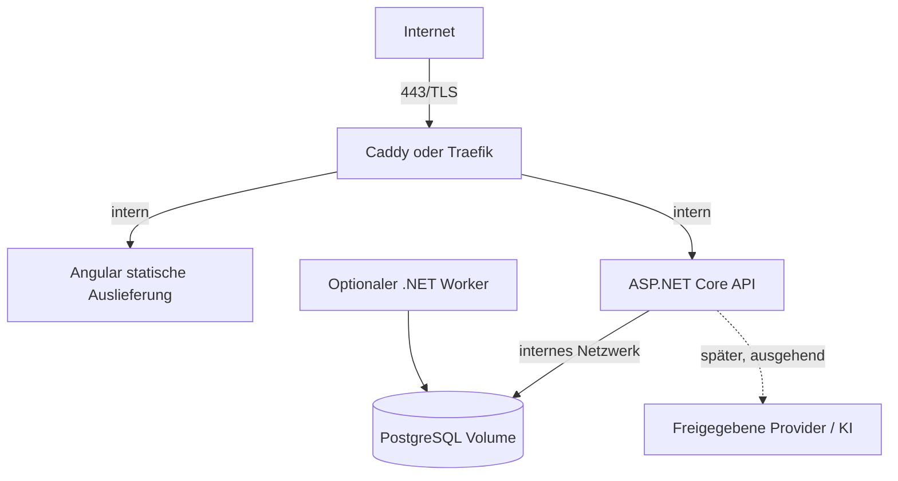

# Küchenfuchs – Deployment- und Betriebskonzept

**Stand:** 10. Oktober 2026 · **Status:** Zielbild; keine Ressourcen werden mit diesem Dokument gestartet oder provisioniert

## Lokale Entwicklung (P0)

Voraussetzung ist Docker mit Docker Compose v2.29 oder neuer. Im Repository-Stamm liegt `.env.example` mit ausschließlich lokalen, ausdrücklich nicht produktiven Werten. Compose verlangt `POSTGRES_PASSWORD` ohne fest hinterlegten Fallback; die echte lokale `.env` wird nicht versioniert:

```sh
cp .env.example .env
# .env ausfüllen: INITIAL_ADMIN_EMAIL, INITIAL_ADMIN_PASSWORD,
# INITIAL_HOUSEHOLD_NAME und POSTGRES_PASSWORD. Bootstrap-Passwort erzeugen:
openssl rand -base64 32
docker compose up --build --detach
```

Das Bootstrap-Passwort muss mindestens 14 Zeichen enthalten sowie Groß-/Kleinbuchstaben, eine Ziffer und ein Sonderzeichen. Bei leerer Datenbank führt die API die versionierten EF-Core-Migrationen aus und legt den Initialadministrator, die Administratorrolle, den ersten Haushalt und dessen Owner-Mitgliedschaft an. Ohne vollständige Bootstrap-Konfiguration schlägt der API-Start explizit fehl; es gibt kein Standardpasswort. Die Bootstrap-Variablen werden bei bereits vorhandenen Benutzern ignoriert und ändern keine bestehenden Zugangsdaten. Änderungen am Passwort müssen über einen dafür vorgesehenen Benutzerverwaltungsprozess erfolgen.

Danach ist die Angular-Anwendung standardmäßig unter <http://localhost:8080> verfügbar. API-Liveness und die PostgreSQL-Bereitschaft sind über `/api/health/live` und `/api/health/ready` erreichbar. Caddy lauscht für lokale Entwicklung ausschließlich auf `127.0.0.1`; `HTTP_PORT` in `.env` ändert den Host-Port. Es gibt kein TLS und keine öffentliche Domain. Der PostgreSQL-Dienst hat keinen Host-Port. Der Ready-Check bestätigt eine tatsächliche Datenbankverbindung.

Kommandos aus dem Repository-Stamm:

| Aktion | Kommando | Verhalten |
|---|---|---|
| Stack starten | `docker compose up --build --detach` | Baut/erstellt Dienste und wartet nicht interaktiv; Datenbankvolume bleibt erhalten. |
| Laufende Logs ansehen | `docker compose logs --follow --tail=100` | Beenden mit `Ctrl+C`; Dienste laufen weiter. |
| Stack anhalten | `docker compose stop` | Stoppt Container, entfernt sie nicht und behält das Datenbankvolume. |
| Gestoppten Stack fortsetzen | `docker compose start` | Startet vorhandene Container ohne Neubau. |
| Dienste neu starten | `docker compose restart` | Startet Container neu; neu geänderter Code wird nicht eingebaut. |
| Änderungen neu bauen und starten | `docker compose up --build --detach` | Baut Images neu und ersetzt nötige Container; persistente Daten bleiben erhalten. |
| Stack entfernen | `docker compose down` | Entfernt Container und Netzwerke; persistentes PostgreSQL-Volume bleibt erhalten. |
| P0 Build-/Smoke-Tests | `./scripts/test-p0.sh` | Prüft Compose-Konfiguration, baut Images, startet einen isolierten Test-Stack, prüft Dienste/Proxy/DB/Portisolation und ausgeliefertes Angular-Bundle, und entfernt danach den Test-Stack samt Testvolume. Bei Portkonflikt z. B. `HTTP_PORT=51287 ./scripts/test-p0.sh` verwenden. |
| P2 Auth-Integrationstests | `./scripts/test-p2-auth.sh` | Isolierter Stack prüft Erstbootstrap, anonymen Zugriff, CSRF, Login, Cookie-Flags, Haushaltsisolation, Logout und Sitzungsablauf; Testvolume wird entfernt. |

`docker compose down --volumes` löscht das lokale Datenbankvolume und damit gespeicherte Daten; nicht als normalen Stopp-/Neustartschritt verwenden. P2 führt in der lokalen Development-Compose-Umgebung versionierte EF-Core-Migrationen beim API-Start aus. Für produktive Deployments Migrationen als kontrollierten Release-Schritt vor dem API-Start ausführen; nicht parallel durch mehrere API-Replikate starten lassen.

Wenn Port 8080 bereits belegt ist, `HTTP_PORT` in `.env` setzen oder für den Test `HTTP_PORT=51287 ./scripts/test-p0.sh` verwenden. PostgreSQL und API bleiben ohne Host-Port.

### P0-Prüfergebnisse

P0-Basisprüfungen erneut ausgeführt am 11.10.2026:

| Prüfung | Ergebnis |
|---|---|
| `npm --prefix frontend run build` | Bestanden; Angular-Produktionsbundle erstellt. |
| `dotnet build backend/Kuechenfuchs.Api/Kuechenfuchs.Api.csproj --configuration Release` | Bestanden; 0 Warnungen, 0 Fehler. |
| `docker compose config --quiet` | Bestanden; Compose-Konfiguration ist valide. |
| `env -u POSTGRES_PASSWORD docker compose --env-file /dev/null config --quiet` | Erwartet fehlgeschlagen; Compose weist ein nicht gesetztes PostgreSQL-Kennwort ab. |
| `HTTP_PORT=54391 ./scripts/test-p0.sh` | Bestanden; Angular-/API-Images gebaut, DB/API/Caddy-Healthchecks grün, `lang="de"` und ausgeliefertes Angular-JavaScript-Bundle mit erwartetem App-Inhalt über Caddy geprüft, PostgreSQL-Bereitschaft bestätigt, kein Host-Port für DB oder API. Isolierter Test-Stack und Testvolume wurden danach entfernt. Port 8080 war bereits belegt; der Test wurde deshalb auf 54391 wiederholt. |

### P2-Prüfergebnisse

Ausgeführt am 11.10.2026:

| Prüfung | Ergebnis |
|---|---|
| `dotnet build backend/Kuechenfuchs.Api/Kuechenfuchs.Api.csproj --configuration Release` | Bestanden; 0 Warnungen, 0 Fehler. |
| `npm --prefix frontend test` | Bestanden; 4 Testdateien, 9 Tests. |
| `npm --prefix frontend run build` | Bestanden; Angular-Produktionsbuild einschließlich Login-Seite. |
| `HTTP_PORT=54392 ./scripts/test-p2-auth.sh` | Bestanden; frischer Compose-Stack führte EF-Migrationen und Bootstrap aus; CSRF, gültige/ungültige Anmeldung, HttpOnly/SameSite-Cookie, Haushaltsisolation, Logout und Sitzungsablauf geprüft. Test-Container, -Netzwerke und -Volumes entfernt. |
| `bash -n scripts/test-p0.sh scripts/test-p2-auth.sh` und `git diff --check` | Bestanden. |

## Zieltopologie

Docker Compose ist ab dem ersten Entwicklungspaket die einheitliche lokale Laufzeit für Frontend, API, PostgreSQL und Reverse Proxy. Derselbe modulare Zuschnitt wird später auf einen einzelnen Linux-Server übertragen; der Reverse Proxy ist der einzige Dienst mit veröffentlichten Ports. Für die externe ChatGPT-Action ist zusätzlich ein freigegebener, öffentlich erreichbarer HTTPS-Testendpunkt mit registrierter OAuth-Konfiguration nötig; lokale Entwicklung allein genügt dafür nicht.



### Compose-Dienste

- Vom ersten Paket an: Compose-Datei, Beispielkonfiguration ohne Secrets, Healthchecks, persistentes lokales Datenbankvolume und dokumentierter Start-/Stopp-/Reset-Ablauf. Die Entwicklungsumgebung verwendet keine extern gestartete Datenbank.
- `proxy`: öffentliche Ports 80/443, automatische Zertifikatsverwaltung nach Hostname/Erreichbarkeit.
- `web`: statische Angular-Dateien; keine Secrets.
- `api`: ASP.NET Core, non-root, Readiness/Liveness-Endpunkte, keine öffentlichen Hostports.
- `db`: PostgreSQL, nicht nach außen veröffentlicht, persistentes Volume, Healthcheck.
- `worker`: erst später; separates Startprofil/Service mit gleicher versionierter Anwendung und begrenzten DB-Rechten, wenn geplante Erfassung gebraucht wird.

API und Worker dürfen nicht unkontrolliert denselben periodischen Job doppelt ausführen. Vor mehr als einem Worker muss Exklusivität/Leasing für Jobs entworfen werden. Im MVP ist kein geplanter Beschaffungsjob nötig.

## Netzwerk und Härtung

- Nur Reverse Proxy veröffentlicht Ports. Datenbank und interne Dienste verbleiben im Compose-Netz.
- TLS erzwingen; Redirect HTTP→HTTPS, HSTS erst bei stabiler Domain/TLS-Konfiguration.
- Container ohne privilegierte Rechte, minimale Images, read-only Dateisystem wo möglich, explizite Healthchecks und Ressourcenlimits nach Lastmessung.
- Ausgehender Netzwerkzugriff auf externe Anbieter nur, wenn benötigt; URL-Import erhält gesonderte Egress-Schutzmaßnahmen.
- Logs nach außen begrenzt, rotierend und ohne Passwörter, Tokens, komplette Rezepteingaben oder KI-Inhalte.
- Healthchecks nicht mit Auth-Bypass für fachliche Daten verwechseln; Betriebsendpunkte geben keine Konfiguration/Versionen mit Geheimnissen preis.

## Secrets und Konfiguration

- Keine Secrets oder echten `.env`-Dateien committen. Nur `.env.example` mit nicht-sensiblen Schlüsselnamen/Platzhaltern.
- Für Compose lokale Secret-Dateien (read-only gemountet) bzw. unterstützte Compose-Secrets nutzen; beachten, dass lokale Compose-Secrets keine zentrale Vault-Lösung sind.
- DB-Passwort, Cookie/Data-Protection-Schlüssel, OAuth-Secrets und OpenAI-Schlüssel getrennt, mit minimalen Rechten, außerhalb des Git-Verzeichnisses verwalten.
- Nicht-sensitive Konfiguration (Base URL, Log-Level, Feature-Flags) per Umgebungsvariablen; Secret-Werte bevorzugt aus gemounteten Dateien/Secret Store lesen.
- Secret-Rotation mit dokumentiertem Ablauf; niemals Geheimnisse in Build-Args, Image-Layern oder Logs.

## Migrationen und Updates

1. Versionierte Container-Images mit unveränderlichem Tag/Digest bauen; niemals `latest` für produktive Rollbacks verwenden.
2. Release-Notiz mit Datenbankänderungen, Backupstatus und Kompatibilität erstellen.
3. Vor Migration verschlüsseltes Backup erstellen und Lesbarkeit prüfen.
4. Migration vor API-Start in kontrolliertem Schritt ausführen; bei Fehler Deployment stoppen, nicht mit inkonsistenten App-Versionen weiterlaufen.
5. Smoke Tests für Health, Anmeldung, Rezeptabruf, Einkaufsliste und Empfehlung.
6. Rollback auf kompatibles vorheriges Image; Datenbankschema nicht blind rückwärts migrieren. Wiederherstellung aus Backup mit definiertem RPO/RTO durchspielen.
7. Sicherheitsupdates von Basisimages/Frameworks regelmäßig prüfen und kontrolliert einspielen.

## Backups und Wiederherstellung

- PostgreSQL konsistent sichern (z. B. `pg_dump` mit komprimierter Ausgabe und verschlüsseltem Ziel), planmäßige Rotation und mindestens eine Kopie außerhalb des Servers.
- Backup enthält sensible Haushaltsdaten; Zugriff und Aufbewahrungsfristen begrenzen, Schlüssel getrennt vom Backup lagern.
- Regelmäßig Restore in isolierte Testumgebung durchführen; Backup-Erfolg nicht nur am Exitcode des Jobs festmachen.
- RPO/RTO sind vor Betrieb gemeinsam festzulegen. Startvorschlag für privaten MVP: tägliches Backup, maximal 24 Stunden Datenverlust tolerieren; Wiederherstellungsziel innerhalb eines Tages – ausdrücklich vom Auftraggeber zu bestätigen.
- Benutzer-/Rezeptfotos, falls später eingeführt, benötigen eigenen Backup- und Löschplan. Keine Uploads im MVP voraussetzen.

## Frühe Entwicklungsumgebung und spätere Produktionshärtung

- Compose-Konfiguration ab Paket 0 muss einen reproduzierbaren lokalen Start der Kernkomponenten und einen Smoke-Test ermöglichen; Produktionskonfiguration wird später gehärtet, nicht erst dann grundsätzlich eingeführt.
- Lokale Secrets bleiben außerhalb des Repositories; Beispielwerte sind nicht als produktive Zugangsdaten nutzbar.
- Die öffentlich erreichbare HTTPS-Testumgebung für ChatGPT Actions wird erst eingerichtet, wenn Domain, OAuth-Redirects und Zugriffsschutz freigegeben sind. Kein Tunnel und kein ungeschützter temporärer Endpunkt als Abkürzung.
- Automatisierte Builds/Tests laufen pro Arbeitspaket; Compose-Validierung und Container-Builds sind Teil der passenden Tests, nicht Anlass, im Planungsstadium Container auszuführen.

## Beobachtbarkeit und Betrieb

- Strukturierte Logs, Request-ID, API-Fehlerraten, DB-Verbindungsstatus, Speicherplatz, Backup-Ergebnis und Worker-Fehler überwachen.
- Datenschutzarme Metriken; kein Inhalt von Rezepten/Prompts in Telemetrie.
- Health-/Readinesschecks für Proxy, API und DB; Alarmierung auf Ausfall/Backupfehler.
- Datenanbieter pro Quelle deaktivierbar, mit Timeout/Backoff und sichtbarem Status.
- Kein Deployment, kein Containerstart und keine Provisionierung im Rahmen der Planerstellung.
