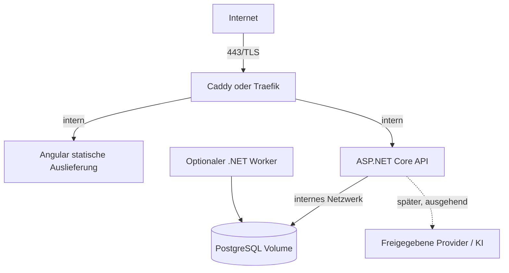

# Küchenfuchs – Deployment- und Betriebskonzept

**Stand:** 10. Oktober 2026 · **Status:** Zielbild; keine Ressourcen werden mit diesem Dokument gestartet oder provisioniert

## Zieltopologie

Ein einzelner Linux-Server, Docker Compose, ein öffentlicher HTTPS-Einstiegspunkt. Ein Compose-Projekt verwaltet Frontend, API, PostgreSQL und später optional einen Worker. Reverse Proxy ist der einzige Dienst mit veröffentlichten Ports.

### Compose-Dienste

- `proxy`: öffentliche Ports 80/443, automatische Zertifikatsverwaltung nach Hostname/Erreichbarkeit.
- `web`: statische Angular-Dateien; keine Secrets.
- `api`: ASP.NET Core, non-root, Readiness/Liveness-Endpunkte, keine öffentlichen Hostports.
- `db`: PostgreSQL, nicht nach außen veröffentlicht, persistentes Volume, Healthcheck.
- `worker`: erst später; separates Startprofil/Service mit gleicher versionierter Anwendung und begrenzten DB-Rechten, wenn geplante Erfassung gebraucht wird.

API und Worker dürfen nicht unkontrolliert denselben periodischen Job doppelt ausführen. Vor mehr als einem Worker muss Exklusivität/Leasing für Jobs entworfen werden. Im MVP ist kein geplanter Beschaffungsjob nötig.

## Netzwerk und Härtung

- Nur Reverse Proxy veröffentlicht Ports. Datenbank und interne Dienste verbleiben im Compose-Netz.
- TLS erzwingen; Redirect HTTP→HTTPS, HSTS erst bei stabiler Domain/TLS-Konfiguration.
- Container ohne privilegierte Rechte, minimale Images, read-only Dateisystem wo möglich, explizite Healthchecks und Ressourcenlimits nach Lastmessung.
- Ausgehender Netzwerkzugriff auf externe Anbieter nur, wenn benötigt; URL-Import erhält gesonderte Egress-Schutzmaßnahmen.
- Logs nach außen begrenzt, rotierend und ohne Passwörter, Tokens, komplette Rezepteingaben oder KI-Inhalte.
- Healthchecks nicht mit Auth-Bypass für fachliche Daten verwechseln; Betriebsendpunkte geben keine Konfiguration/Versionen mit Geheimnissen preis.

## Secrets und Konfiguration

- Keine Secrets oder echten `.env`-Dateien committen. Nur `.env.example` mit nicht-sensiblen Schlüsselnamen/Platzhaltern.
- Für Compose lokale Secret-Dateien (read-only gemountet) bzw. unterstützte Compose-Secrets nutzen; beachten, dass lokale Compose-Secrets keine zentrale Vault-Lösung sind.
- DB-Passwort, Cookie/Data-Protection-Schlüssel, OAuth-Secrets und OpenAI-Schlüssel getrennt, mit minimalen Rechten, außerhalb des Git-Verzeichnisses verwalten.
- Nicht-sensitive Konfiguration (Base URL, Log-Level, Feature-Flags) per Umgebungsvariablen; Secret-Werte bevorzugt aus gemounteten Dateien/Secret Store lesen.
- Secret-Rotation mit dokumentiertem Ablauf; niemals Geheimnisse in Build-Args, Image-Layern oder Logs.

## Migrationen und Updates

1. Versionierte Container-Images mit unveränderlichem Tag/Digest bauen; niemals `latest` für produktive Rollbacks verwenden.
2. Release-Notiz mit Datenbankänderungen, Backupstatus und Kompatibilität erstellen.
3. Vor Migration verschlüsseltes Backup erstellen und Lesbarkeit prüfen.
4. Migration vor API-Start in kontrolliertem Schritt ausführen; bei Fehler Deployment stoppen, nicht mit inkonsistenten App-Versionen weiterlaufen.
5. Smoke Tests für Health, Anmeldung, Rezeptabruf, Einkaufsliste und Empfehlung.
6. Rollback auf kompatibles vorheriges Image; Datenbankschema nicht blind rückwärts migrieren. Wiederherstellung aus Backup mit definiertem RPO/RTO durchspielen.
7. Sicherheitsupdates von Basisimages/Frameworks regelmäßig prüfen und kontrolliert einspielen.

## Backups und Wiederherstellung

- PostgreSQL konsistent sichern (z. B. `pg_dump` mit komprimierter Ausgabe und verschlüsseltem Ziel), planmäßige Rotation und mindestens eine Kopie außerhalb des Servers.
- Backup enthält sensible Haushaltsdaten; Zugriff und Aufbewahrungsfristen begrenzen, Schlüssel getrennt vom Backup lagern.
- Regelmäßig Restore in isolierte Testumgebung durchführen; Backup-Erfolg nicht nur am Exitcode des Jobs festmachen.
- RPO/RTO sind vor Betrieb gemeinsam festzulegen. Startvorschlag für privaten MVP: tägliches Backup, maximal 24 Stunden Datenverlust tolerieren; Wiederherstellungsziel innerhalb eines Tages – ausdrücklich vom Auftraggeber zu bestätigen.
- Benutzer-/Rezeptfotos, falls später eingeführt, benötigen eigenen Backup- und Löschplan. Keine Uploads im MVP voraussetzen.

## Beobachtbarkeit und Betrieb

- Strukturierte Logs, Request-ID, API-Fehlerraten, DB-Verbindungsstatus, Speicherplatz, Backup-Ergebnis und Worker-Fehler überwachen.
- Datenschutzarme Metriken; kein Inhalt von Rezepten/Prompts in Telemetrie.
- Health-/Readinesschecks für Proxy, API und DB; Alarmierung auf Ausfall/Backupfehler.
- Datenanbieter pro Quelle deaktivierbar, mit Timeout/Backoff und sichtbarem Status.
- Kein Deployment, kein Containerstart und keine Provisionierung im Rahmen der Planerstellung.
