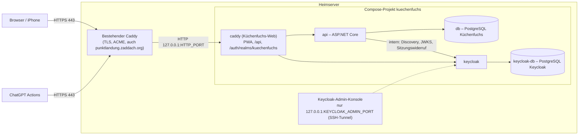

# Küchenfuchs – Heimserver-Einrichtung mit ChatGPT-OAuth (P5a.2)

**Stand:** 11. Oktober 2026
**Status:** Konfiguration vorbereitet und lokal produktionsnah getestet. **Nichts davon ist auf dem Heimserver aktiv.** DNS, Router, öffentliches HTTPS und der Live-Test mit ChatGPT erfolgen erst nach ausdrücklicher Freigabe.

Zielbild: Küchenfuchs läuft wie Punktlandung auf dem eigenen Heimserver mit Docker Compose. Öffentlich erreichbar ist ausschließlich der bereits vorhandene Caddy des Heimservers (HTTPS, Port 443) unter `https://kuechenfuchs.zaddach.org`. Kein Hetzner, keine Cloud, kein Kubernetes.

## Legende

| Markierung | Bedeutung |
|---|---|
| ✅ umgesetzt | Im Repository vorhanden und automatisiert getestet |
| ⏳ nach Freigabe | Muss auf dem Heimserver bzw. im GPT-Editor durch dich erfolgen |
| ❓ Angabe fehlt | Information über deine bestehende Infrastruktur, die ich nicht kenne – bitte vor der Einrichtung klären |

## Architektur auf dem Heimserver



- Eine Origin für alles: PWA `/`, API `/api/…`, OAuth/OIDC `/auth/realms/kuechenfuchs/…`. Das entspricht der OpenAI-Vorgabe, dass OAuth-Domains der API-Domain entsprechen müssen.
- Issuer: `https://kuechenfuchs.zaddach.org/auth/realms/kuechenfuchs`, fest aus `KUECHENFUCHS_PUBLIC_URL` (Keycloak `KC_HOSTNAME`), nie aus Request-Headern.
- Öffentlich gesperrt (doppelt: Edge-Snippet und interner Caddy): `/auth/admin`, `/auth/realms/master`, andere Realms, `/auth/health`, `/auth/metrics`, `/auth/` selbst.
- Keine Datenbank, keine API und kein Keycloak sind direkt öffentlich. Alle Host-Ports sind an `127.0.0.1` gebunden.

## 1. DNS-Eintrag für `kuechenfuchs.zaddach.org` ⏳ ❓

1. ❓ Prüfen, wie `punktlandung.zaddach.org` aufgelöst wird (`dig +short punktlandung.zaddach.org A` / `AAAA`): feste IP, DynDNS-Name oder CNAME?
2. Denselben Mechanismus verwenden:
   - Bei DynDNS-Hostnamen: `kuechenfuchs.zaddach.org  CNAME  <dein-dyndns-name>`.
   - Bei fester IPv4: `kuechenfuchs.zaddach.org  A  <öffentliche IPv4>`; bei IPv6-Erreichbarkeit zusätzlich `AAAA`.
3. Keine Wildcard-Einträge anlegen. TTL anfangs niedrig (z. B. 300 s).
4. Kontrolle: `dig +short kuechenfuchs.zaddach.org` liefert dieselbe Adresse wie Punktlandung.

## 2. Öffentliche Erreichbarkeit des Heimanschlusses prüfen ⏳

- Da Punktlandung bereits per HTTPS erreichbar ist, sind Port 80/443 vermutlich schon an den Heimserver weitergeleitet. ❓ Bitte bestätigen.
- Prüfen, dass der Anschluss keine CGNAT-/DS-Lite-Beschränkung für IPv4 hat (sonst nur IPv6 oder Tunnel – Tunnel sind nicht freigegeben).
- Von außen (Mobilfunk, nicht WLAN) nach Einrichtung: `curl -I https://kuechenfuchs.zaddach.org/api/health/live`.
- ChatGPT ruft von OpenAI-IP-Bereichen aus auf. Eine IP-Allowlist ist optional und würde den Browserzugriff der PWA nicht betreffen, wenn sie nur auf `/api/v1/integrations/chatgpt` angewendet wird – vorerst nicht vorgesehen.

## 3. Router- und Firewall-Freigaben ⏳ ❓

- Keine neuen Portweiterleitungen nötig, wenn 80/443 bereits zum Heimserver-Caddy gehen. ❓ Bitte bestätigen.
- Hostfirewall (z. B. `ufw`): nur 80/tcp und 443/tcp (und ggf. 443/udp für HTTP/3) öffentlich. `HTTP_PORT` und `KEYCLOAK_ADMIN_PORT` sind ohnehin nur an `127.0.0.1` gebunden und dürfen **nicht** freigegeben werden.
- Port 80 wird nur für ACME-HTTP-01 und die automatische Weiterleitung auf HTTPS gebraucht.

## 4. Caddy-Integration ohne Beeinträchtigung von Punktlandung ✅ Vorlage · ⏳ Einbau

Vorlagen im Repository (✅):

- `deploy/caddy/edge/kuechenfuchs.caddy` – Snippet `kuechenfuchs_edge` (HSTS, nosniff, Admin-/Master-/Health-Pfade gesperrt, `reverse_proxy`).
- `deploy/caddy/edge/Caddyfile.homeserver.example` – zusätzlicher Site-Block.

Einbau (⏳), ohne bestehende Konfiguration zu überschreiben:

1. ❓ Feststellen, wie Caddy auf dem Heimserver läuft: als Systemdienst (`systemctl status caddy`) oder als Container (z. B. im Punktlandung-Compose-Projekt) und wo das Caddyfile liegt.
2. Sicherung des bestehenden Caddyfiles anlegen (`cp Caddyfile Caddyfile.bak-$(date +%F)`).
3. `kuechenfuchs.caddy` neben das Caddyfile kopieren und **nur** ergänzen:
   ```caddy
   import /etc/caddy/kuechenfuchs.caddy

   kuechenfuchs.zaddach.org {
   	import kuechenfuchs_edge 127.0.0.1:8081
   }
   ```
4. Upstream je nach Caddy-Betriebsart:
   - Caddy als Systemdienst: `127.0.0.1:<HTTP_PORT>`.
   - Caddy als Container: `127.0.0.1` zeigt auf den Container selbst. Entweder `host.docker.internal:<HTTP_PORT>` (unter Linux mit `extra_hosts: ["host.docker.internal:host-gateway"]` am Caddy-Container; dann `HTTP_BIND_ADDRESS` auf die Docker-Bridge-Adresse, z. B. `172.17.0.1`, setzen – nie `0.0.0.0`) **oder** ein gemeinsames, ausschließlich dafür angelegtes externes Docker-Netzwerk, an das nur Edge-Caddy und `kuechenfuchs-caddy-1` angeschlossen werden. Diese Entscheidung bitte vor der Einrichtung treffen; ich verändere keine Punktlandung-Netze.
5. **Vertrauenswürdige Proxy-Adressen festlegen (Pflicht):** Nur konkret benannte Absender dürfen `X-Forwarded-*` liefern.
   - Kette: Heimserver-Caddy → Küchenfuchs-Caddy (feste Adressen `KUECHENFUCHS_PROXY_IP`, Standard `172.31.240.10` im Netz `backend`, und `KUECHENFUCHS_PROXY_INGRESS_IP`, Standard `172.31.241.10` im Netz `ingress`) → API/Keycloak. API (`ReverseProxy__KnownProxies`) und Keycloak (`KC_PROXY_TRUSTED_ADDRESSES`) vertrauen ausschließlich diesen Adressen; zu breite Netze (< /24) verweigert die API beim Start.
   - Der Küchenfuchs-Caddy vertraut nur `KUECHENFUCHS_EDGE_PROXY_ADDRESSES`. Diese Adresse ist der Absender, mit dem der Heimserver-Caddy beim Küchenfuchs-Caddy ankommt:
     - Systemdienst-Caddy → `127.0.0.1:<HTTP_PORT>`: Docker leitet über das Gateway des `ingress`-Netzes weiter, also `172.31.241.1/32` (bei Standard-Subnetz). ❓ Bitte auf dem Server bestätigen.
     - Container-Caddy über die Docker-Bridge: Gateway der Bridge, z. B. `172.17.0.1/32`.
     - Container-Caddy in einem gemeinsamen Netz: dessen feste Adresse in diesem Netz.
   - Kontrolle nach dem Start: Login in der PWA über `https://kuechenfuchs.zaddach.org` funktioniert (sonst `CSRF validation failed`, siehe Fehlerdiagnose).
   - Subnetze `KUECHENFUCHS_BACKEND_SUBNET`/`KUECHENFUCHS_INGRESS_SUBNET` vorher auf Kollisionen prüfen (`ip route`, `docker network ls`, `docker network inspect …`).
6. Syntax prüfen, dann ohne Unterbrechung neu laden: `caddy validate --config Caddyfile` und `caddy reload --config Caddyfile` (bzw. `docker exec <caddy-container> caddy reload --config /etc/caddy/Caddyfile`).
7. Punktlandung danach kurz prüfen (`curl -I https://punktlandung.zaddach.org`).

## 5. HTTPS-Zertifikat ⏳

- Caddy beschafft das Zertifikat für `kuechenfuchs.zaddach.org` automatisch per ACME (Let's Encrypt/ZeroSSL), sobald DNS auf den Heimserver zeigt und Port 80/443 erreichbar sind. Kein eigenes TLS in Küchenfuchs.
- Kontrolle: `curl -vI https://kuechenfuchs.zaddach.org 2>&1 | grep -E 'subject|issuer|TLS'` (TLS 1.2 oder neuer, öffentlich gültige Kette). OpenAI verlangt TLS 1.2+ auf Port 443.
- HSTS wird vom Snippet mit `max-age=31536000` (ohne `preload`) gesetzt.

## 6. Docker-Compose-Konfiguration ✅

Auf dem Heimserver im Repository-Verzeichnis (eigener Ordner, z. B. `/srv/kuechenfuchs`):

```sh
docker compose -f compose.yaml -f compose.keycloak.yaml -f compose.homeserver.yaml config --quiet
docker compose -f compose.yaml -f compose.keycloak.yaml -f compose.homeserver.yaml up --build --detach
```

- Projektname `kuechenfuchs` (in `compose.homeserver.yaml` fest), daher eigene Container-, Netzwerk- und Volume-Namen (`kuechenfuchs_…`). Punktlandung bleibt unberührt.
- ❓ Freien `HTTP_PORT` wählen: `ss -ltnp | grep -E ':(8080|8081|8180|8181)\b'`. 8080 ist auf deinem Mac bereits belegt; auf dem Server vorher prüfen. Ebenso `KEYCLOAK_ADMIN_PORT`.
- Der Dienst `migrate` führt EF-Core-Migrationen einmalig aus (`--migrate`); die API startet erst nach erfolgreicher Migration und läuft in `Production` (Cookies `__Host-…`, keine OpenAPI-Ausgabe).
- Die API wertet `X-Forwarded-Proto`/`-For` nur vom Küchenfuchs-Caddy (`ReverseProxy__KnownProxies`, feste Adresse) und nur eine Weiterleitungsstufe aus, nie `X-Forwarded-Host`.
- Alle Images sind gepinnt (PostgreSQL 17.11, Caddy 2.11.7, Keycloak 26.7.5 jeweils mit Digest).
- Keine globalen Aufräumbefehle (`docker system prune`, `docker volume prune`) verwenden.

## 7. Secrets erzeugen und hinterlegen ⏳

Auf dem Server eine `.env` neben den Compose-Dateien anlegen (`chmod 600 .env`, Besitzer = Betriebsbenutzer, nie committen):

```sh
umask 077
gen() { openssl rand -base64 48 | tr -d '\n/+='; }
cat > .env <<EOF
KUECHENFUCHS_PUBLIC_URL=https://kuechenfuchs.zaddach.org
HTTP_PORT=8081
KEYCLOAK_ADMIN_PORT=8181
POSTGRES_PASSWORD=$(gen)
KEYCLOAK_DB_PASSWORD=$(gen)
KEYCLOAK_ADMIN_USERNAME=kuechenfuchs-admin
KEYCLOAK_ADMIN_PASSWORD=$(gen)
KEYCLOAK_LINK_CLIENT_SECRET=$(gen)
KEYCLOAK_CHATGPT_ACTIONS_CLIENT_SECRET=$(gen)
KEYCLOAK_API_ADMIN_CLIENT_SECRET=$(gen)
# Vertrauenswürdige Proxy-Kette (Abschnitt 4, Punkt 5); Subnetze nur bei Kollision ändern.
KUECHENFUCHS_EDGE_PROXY_ADDRESSES=172.31.241.1/32
KUECHENFUCHS_BACKEND_SUBNET=172.31.240.0/24
KUECHENFUCHS_INGRESS_SUBNET=172.31.241.0/24
KUECHENFUCHS_PROXY_IP=172.31.240.10
KUECHENFUCHS_PROXY_INGRESS_IP=172.31.241.10
EOF
```

- Für die einmalige Ersteinrichtung zusätzlich `INITIAL_ADMIN_EMAIL`, `INITIAL_ADMIN_PASSWORD`, `INITIAL_HOUSEHOLD_NAME` setzen und nach dem Bootstrap wieder entfernen (siehe `docs/deployment.md`).
- Die `.env` zusätzlich in einem Passwortmanager sichern. Das ChatGPT-Client-Secret wird später im GPT-Editor eingetragen und nirgends sonst gespeichert.
- Keine produktiven Daten oder Benutzer aus Testumgebungen übernehmen.

## 8. Datenbanken und Persistenz ✅

| Volume | Inhalt |
|---|---|
| `kuechenfuchs_postgres_data` | Küchenfuchs-Datenbank (Benutzer, Haushalte, Rezepte, Verknüpfungen) |
| `kuechenfuchs_keycloak_postgres_data` | Eigene PostgreSQL-Instanz nur für Keycloak (Realm, Keycloak-Benutzer, Sitzungen) |
| `kuechenfuchs_aspnet_data_protection` | ASP.NET-Data-Protection-Schlüssel (Cookies, PKCE-Verifier der Verknüpfung) |

Die beiden Datenbanken sind logisch und netzwerkseitig getrennt (`keycloak-db` nur im internen Netz `keycloak-backend`; die API erreicht es nicht).

## 9. Keycloak initial einrichten ⏳

1. Stack starten (Schritt 6). Der Realm `kuechenfuchs` wird beim ersten Start aus `deploy/keycloak/import/kuechenfuchs-realm.json` importiert (ohne Benutzer, ohne Selbstregistrierung, Brute-Force-Schutz, 300 s Access-Token).
2. Admin-Konsole nur per SSH-Tunnel: `ssh -L 8181:127.0.0.1:8181 <heimserver>` → `http://localhost:8181/auth/admin/`.
3. Mit dem Bootstrap-Admin anmelden, im Realm `master` einen dauerhaften persönlichen Admin mit starkem Passwort und OTP anlegen, dann den Bootstrap-Admin löschen und `KEYCLOAK_ADMIN_PASSWORD` aus `.env` entfernen.
4. Im Realm `kuechenfuchs` für jede Person einen Benutzer anlegen (Benutzername, Passwort, optional OTP). Keycloak-Benutzer erhalten **keinen** Zugriff, solange sie nicht ausdrücklich in der PWA verknüpft werden; E-Mail-Adressen spielen dafür keine Rolle.

## 10. OAuth-Client für ChatGPT konfigurieren ✅ vorbereitet · ⏳ Werte

Der Client `chatgpt-actions` ist importiert: vertraulich, nur Authorization Code, keine Redirect-URIs, Audience `kuechenfuchs-api`, optionale Scopes `recipes:read`/`recipes:write`, keine E-Mail-/Profil-Claims, kein `offline_access`, Refresh-Token-Rotation (Wiederverwendung abgelehnt).

Werte für den GPT-Editor („Authentication → OAuth“):

| Feld | Wert |
|---|---|
| Client ID | `chatgpt-actions` |
| Client Secret | Wert aus `KEYCLOAK_CHATGPT_ACTIONS_CLIENT_SECRET` (oder neu: `scripts/keycloak-chatgpt-client.sh rotate-secret`) |
| Authorization URL | `https://kuechenfuchs.zaddach.org/auth/realms/kuechenfuchs/protocol/openid-connect/auth` |
| Token URL | `https://kuechenfuchs.zaddach.org/auth/realms/kuechenfuchs/protocol/openid-connect/token` |
| Scope | `openid recipes:read` (Schreibrechte erst mit P5b) |
| Token Exchange Method | Beide Varianten (Body/POST und Basic-Header) sind in Keycloak getestet; die von der Oberfläche angebotene Standardeinstellung verwenden und im Live-Test bestätigen. |

## 11. GPT-ID und exakte Callback-URIs eintragen ⏳

1. GPT im Editor speichern; die GPT-ID (`g-…`) aus der Adresszeile bzw. der angezeigten Callback-URL ablesen.
2. Nur die von der ChatGPT-Oberfläche angezeigten Callback-URIs eintragen. Laut OpenAI-Dokumentation (11.10.2026) haben sie die Form `https://chat.openai.com/aip/<g-ID>/oauth/callback` und `https://chatgpt.com/aip/<g-ID>/oauth/callback`:
   ```sh
   scripts/keycloak-chatgpt-client.sh set-redirect-uris \
     https://chatgpt.com/aip/g-XXXXXXXX/oauth/callback \
     https://chat.openai.com/aip/g-XXXXXXXX/oauth/callback
   scripts/keycloak-chatgpt-client.sh show
   ```
   Das Skript akzeptiert nur exakt diese Form (keine Wildcards, kein HTTP, keine fremden Hosts). Ändert sich die GPT-ID, den Befehl mit den neuen URIs erneut ausführen (ersetzt die Liste vollständig).
3. Falls ChatGPT nachweislich PKCE S256 sendet (Live-Test, Schritt 13): `scripts/keycloak-chatgpt-client.sh pkce required`.

## 12. Testbenutzer mit Küchenfuchs verknüpfen ⏳

1. In der PWA anmelden (normale Küchenfuchs-Anmeldung, unverändert).
2. **Einstellungen → ChatGPT-Verbindung**: genau einen Haushalt wählen, Bestätigung anhaken, „Mit Keycloak verknüpfen“.
3. Bei Keycloak mit dem Keycloak-Benutzer anmelden (immer neue Anmeldung erzwungen). Rückkehr zur PWA mit Meldung.
4. Status zeigt „Keycloak-Konto verknüpft“; „ChatGPT noch nicht autorisiert“ bis zur Anmeldung aus dem GPT.
5. Für den ersten Test einen eigenen Testhaushalt mit synthetischen Rezepten verwenden.

## 13. Verbindung aus ChatGPT testen ⏳

Es gibt in P5a.2 noch keine Rezept-Actions (P5b). Für den Verbindungstest eine minimale Action mit nur dem Diagnose-Endpunkt verwenden:

```yaml
openapi: 3.1.0
info: { title: Küchenfuchs Verbindungstest, version: "0.1" }
servers: [ { url: https://kuechenfuchs.zaddach.org } ]
paths:
  /api/v1/integrations/chatgpt/households/{householdId}/authorization-check:
    get:
      operationId: checkKuechenfuchsAuthorization
      parameters: [ { name: householdId, in: path, required: true, schema: { type: string, format: uuid } } ]
      responses: { "200": { description: OK } }
```

Prüfliste (Interoperabilität – Ergebnisse in `docs/chatgpt-actions-oauth.md` nachtragen):

1. Anmeldung aus dem GPT führt zur Keycloak-Anmeldeseite unter `kuechenfuchs.zaddach.org` und zurück zu ChatGPT.
2. Keycloak-Log (`docker compose … logs keycloak`) zeigt erfolgreichen Code-Austausch; welche Client-Authentifizierung (Basic/Body) und ob `code_challenge` gesendet wurde.
3. Diagnose-Aufruf mit der Haushalts-ID des verknüpften Haushalts → `200` mit `status: authorized`; anderer Haushalt → `404`.
4. PWA zeigt nun „ChatGPT autorisiert“ und den letzten Zugriff.
5. Nach > 5 Minuten erneut aufrufen → ChatGPT erneuert per Refresh-Token ohne neue Anmeldung (bis zum Sitzungs-Idle-Timeout von 30 Minuten, siehe offene Entscheidung D20).
6. In der PWA „Verbindung trennen“ → nächster ChatGPT-Aufruf scheitert, erneute Anmeldung nötig.
7. Neu verknüpfen und neu anmelden → funktioniert nur für den neu gewählten Haushalt.

## 14. Fehlerdiagnose

| Symptom | Ursache / Prüfung |
|---|---|
| Keycloak-Seite „Invalid parameter: redirect_uri“ | Callback-URI nicht exakt eingetragen → Schritt 11, `show` prüfen |
| ChatGPT: Token-Austausch fehlgeschlagen, Keycloak `unauthorized_client` | Client-Secret im GPT-Editor falsch oder rotiert; ggf. andere Token-Exchange-Methode wählen |
| Keycloak `invalid_request … code_challenge` | PKCE auf `required` gesetzt, aber ChatGPT sendet kein PKCE → `pkce optional` |
| API `401` trotz Anmeldung | Kein aktiver Link (PWA-Status), Benutzer gesperrt, Token vor der Verknüpfung ausgestellt (erneut in ChatGPT anmelden) oder falscher Issuer (`KUECHENFUCHS_PUBLIC_URL` ≠ tatsächliche Adresse) |
| API `403` | Scope `recipes:read` fehlt im GPT-Editor |
| API `404` | Haushalts-ID gehört nicht zum verknüpften Haushalt oder Mitgliedschaft entfernt |
| API `429` | Rate Limit (Standard 60/min je Verknüpfung, `CHATGPT_BEARER_REQUESTS_PER_MINUTE`) |
| PWA-Verknüpfung „unavailable“ | API erreicht Keycloak intern nicht oder Service-Account-Secret falsch: `docker compose … logs api keycloak` |
| Login in der PWA scheitert mit `CSRF validation failed` bzw. HTTP 500 hinter HTTPS | `KUECHENFUCHS_EDGE_PROXY_ADDRESSES` entspricht nicht der tatsächlichen Absenderadresse des Heimserver-Caddys, oder `KUECHENFUCHS_PROXY_IP` passt nicht zu `ReverseProxy__KnownProxies` (Abschnitt 4, Punkt 5) |
| Zertifikat wird nicht ausgestellt | DNS, Port 80/443, Caddy-Log des Heimservers |

Nützliche Befehle: `docker compose -f compose.yaml -f compose.keycloak.yaml -f compose.homeserver.yaml ps|logs api keycloak caddy`. Logs enthalten keine Tokens, Codes oder Secrets; Request-URLs werden bewusst nicht protokolliert.

## 15. Backup, Wiederherstellung und Updates ⏳

- **Backup (täglich, verschlüsselt, außer Haus):**
  ```sh
  C="docker compose -f compose.yaml -f compose.keycloak.yaml -f compose.homeserver.yaml"
  $C exec -T db pg_dump -U kuechenfuchs -Fc kuechenfuchs > kuechenfuchs-$(date +%F).dump
  $C exec -T keycloak-db pg_dump -U keycloak -Fc keycloak > keycloak-$(date +%F).dump
  ```
  Zusätzlich `.env` und das Volume `kuechenfuchs_aspnet_data_protection` sichern. Beide Datenbanken gehören zusammen (Verknüpfungen verweisen auf Keycloak-Benutzer-IDs).
- **Wiederherstellung:** in einer isolierten Testumgebung üben; nach Restore nur einer Seite alle Verknüpfungen prüfen und im Zweifel widerrufen.
- **Updates:** Release Notes prüfen, Backup erstellen, Tag **und** Digest in `deploy/keycloak/Dockerfile`, `compose*.yaml` bzw. `Dockerfile` anpassen, lokal `bash scripts/test-p5a-keycloak.sh` und `bash scripts/test-p5a2-chatgpt-oauth.sh` ausführen, dann auf dem Server `up --build --detach`. Kein Downgrade ohne Restore.
